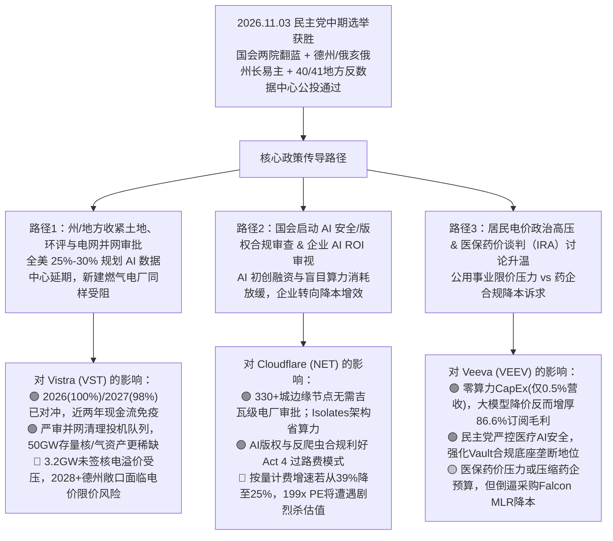

# Cloudflare (NET)、Vistra (VST)、Veeva (VEEV) 最新财报精读、基本面横评与"民主党上台 AI 放缓"多情景估值报告

> **数据截止日期（Data Cutoff Date）**：2026年11月8日（美股最新交易日收盘价取自 2026年11月6日周五）
> **核心事件窗口**：2026年11月3日美国中期选举（民主党赢得参众两院并翻转德州、俄亥俄、佐治亚州长，40/41 项地方反数据中心公投通过）+ 2026年11月5日–6日三家公司密集发布最新财报与 8-K 业绩更新
> **一手资料等级**：**A 级**（全部基于 SEC Form 10-Q / 8-K 原文、官方投资者日/财报演示文稿、电话会实录，并通过 StockAnalysis / Yahoo Finance / GuruFocus 双源交叉核验与 `tools/financial_rigor.py` 精确验算）
> **研究声明**：本报告严格区分客观事实与分析推演（观点均显式标注【观点】或【推测】），仅供学习与研究，不构成投资建议。

---

## AI 研究偏见自觉与逆向思维前提

- **信息丰富度评级**：三家公司均为 **A 级**（华尔街覆盖密集的明星股）。
- **市场共识陷阱识别**：
  1. **对 Cloudflare (NET) 的共识陷阱**：因为 Q3 收入增速跃升至 +39.2%，市场容易陷入"AI Agent 网络基础设施永动机"的线性外推，忽略其 **199x Forward PE / 34x EV/Sales** 的极端估值在宏观或 AI 消耗放缓时的剧烈均值回归风险，以及高达营收 22.2% 的 SBC 稀释。
  2. **对 Vistra (VST) 的共识陷阱**：11月3日中期选举民主党胜出并掀起反数据中心浪潮后，市场恐慌性抛售电力股（选后两日一度暴跌至 $112.89），误以为"新建数据中心审批放缓 = 独立发电商盈利崩塌"，却忽视了 Vistra **2026 年 100% 对冲、2027 年 98% 对冲**的铁桶现金流，以及新建电厂审批收紧反而提升其 **50 GW 存量核电+气电**稀缺性的反身性逻辑。
  3. **对 Veeva (VEEV) 的共识陷阱**：过去半年市场先是过度恐慌 Salesforce 抢走商业 CRM 份额与"AI 消灭按席位收费"（4月砸盘至 $148–$175），随后在 Q2 财报与 11月5日投资者日确认赢下 14 家 Top-20 药企、推出百万美元级 Falcon Agent 后又迅速拉升至 **$303.73**，需警惕"好公司、基本面完美，但短期估值修复已较充分"的赔率下降。

---

## 第一步：上周最新财报与 8-K 核心数据全景总览（双源交叉验证）

上周（2026年11月5日–6日），三家公司同步交出了超预期的成绩单：
- **Cloudflare (NET)**：11月5日盘后发布 **2026Q3 财报（Form 8-K / 10-Q）**，营收同比增速连续第三个季度加速至 **+39.2%**，超指引上限 $45.5M，将首次实现 GAAP 盈利的时间点从 2028 年提前两年至 **2026Q4**。
- **Vistra (VST)**：11月6日盘前发布 **2026Q3 财报（Form 8-K）**，Ongoing Ops Adjusted EBITDA 同比暴增 **+50.4%** 至 $2,378M，上调 2026 指引，**首次将 Meta 核电 PPA 与刚于 10月30日交割的 Cogentrix（5,530 MW 气电）纳入 2027 正式指引（$7.7B–$8.5B EBITDA）**，给出 **2030E 每股 FCFbG ~$24** 目标，并逆势追加 **$1.5B 回购授权**。
- **Veeva Systems (VEEV)**：继 8月26日发布超预期的 **Q2 FY2027 财报（Form 10-Q）** 后，于上周 **11月5日–6日举办 2026 投资者日并提交 Item 2.02 Form 8-K**，正式确认截至 10月31日的 **Q3 FY2027 所有指标均将达到或超越指引**，宣布 Vault CRM 已锁定全球 Top-20 药企中的 **14 家**，并将总潜在市场（TAM）上调 50% 至 **$30B**。

### 1.1 三家公司最新核心财务与估值横评表（截至 2026-11-06 收盘）

| 核心维度 | Cloudflare (NYSE: NET) | Vistra Corp. (NYSE: VST) | Veeva Systems (NYSE: VEEV) |
| :--- | :---: | :---: | :---: |
| **最新财报 / 披露节点** | 2026Q3 10-Q（2026-11-05 发布） | 2026Q3 8-K（2026-11-06 发布） | Q2 FY27 10-Q + 11/05 投资者日 8-K |
| **最新股价（2026-11-06 收盘）** | **$268.75**（财报次日 +9.91%） | **$124.80**（财报当日 +10.55%） | **$303.73**（8月以来 +31.8%） |
| **最新总股本（基本 / 稀释）** | 358.24M / **378.20M** | **339.00M** / ~341.0M（27E ~331M） | 161.91M / **165.06M** |
| **市值（基本 / 稀释，工具验算）** | $96.28B / **$101.64B** ✅ | **$42.31B** ✅ | $49.18B / **$50.13B** ✅ |
| **现金及短期投资** | **$5,128.7M** | **$400.0M**（10/30 交割后备考） | **$7,242.95M** |
| **总有息债务** | **$4,441.9M**（全为 0% 票息可转债） | **$22,815.0M**（已赎回 $1B 优先股） | **$0**（仅 $151.7M 租赁负债） |
| **净现金 / (净债务)** | **+$686.8M（净现金）** | **-$22,415M**（扣保证金后 **-$21,105M**） | **+$7,242.95M（巨额净现金）** |
| **企业价值（EV，稀释/备考）** | **$100.95B**（基本 EV $95.59B） | **$64.72B**（扣保证金后 **$63.41B**） | **$43.04B**（基本 EV $42.09B） |
| **最新单季营收及 YoY 增速** | **$782.5M（+39.2% YoY）** | **$6,347.0M（+27.7% YoY）** | **$927.96M（+17.6% YoY）**（Q3E ~$935M） |
| **毛利率（GAAP / Non-GAAP）** | 71.2% / **72.4%**（同比 -290 bps） | 发电毛利随燃料/对冲波动 | 75.0% / **77.1%**（订阅 **86.6%**） |
| **核心经营利润指标（最新单季）** | Non-GAAP 经营利润 **$137.1M（17.5%）** | Ongoing Adj. EBITDA **$2,378M（+50.4%）** | Non-GAAP 经营利润 **$415.9M（44.8%）** |
| **GAAP 净利润（最新单季）** | **-$34.1M**（含 $174.1M SBC） | **$1,140M**（含 +$559M 未实现对冲） | **$273.4M（+36.5% YoY）** |
| **最新全年业绩指引（FY26E / FY27E）** | FY26E 营收 **$2,963.5M** / EPS **$1.35** | FY26E EBITDA **$7.3B** / FCFbG **$4.5B** | FY27E 营收 **$3,684.5M** / EPS **$9.21** |
| **资本开支强度（CapEx / 营收）** | **17.0%**（Q3 PP&E+软件 $133.3M） | **~14%–17%**（维护 CapEx ~$1.63B/年） | **0.54%**（1H FY27 仅 $9.77M！） |
| **SBC 占营收比例 & 股本年变化** | **22.2%**（稀释股本同比 **+2.5%~3%**） | **0.6%**（累计回购减股 **-30%**） | **14.7%**（回购后稀释股本 **-1.6%**） |
| **当前核心估值倍数（工具精确验算）** | **199.1x PE** \| **34.1x EV/S** \| **335.9x P/FCF** | **9.45x 26E P/FCFbG** \| **7.83x 27E EV/EBITDA** | **33.0x PE** \| **26.2x EV/EBIT** \| **31.7x P/FCF** |

---

## 第二步：三家公司最新财报精读与生意本质深度拆解

### 2.1 Cloudflare (NET)：AI 代理互联网的"过路费与轻量级调度层"，但毛利率与资本开支迎来真实权衡

> **一句话生意本质**：在全球 330+ 个城市边缘节点铺设一张软硬一体的可编程网络，向企业收取网络安全保护费（Zero Trust/WAF），并利用毫秒级启动的 V8 Isolates 架构向 1,000 万开发者和 AI Agent 收取边缘推理与网络调度过路费。

1. **Q3 财报核心亮点（为什么增长从 30% 跃升至 39.2%）**：
   - **企业大单与按量消耗共振**：>$100k ARR 大客户单季净增 **308 家**（创历史最高纪录）达 **5,006 家**，贡献 75% 营收；美元净留存率（DBNR）从 Q2 的 120% 跳升至 **122%**；Current RPO 同比增长 **+37%** 至 ~$1,870M。
   - **Workers 架构在 AI Agent 时代的天然优势**：CEO Matthew Prince 在电话会中一针见血地指出，AI Agent 工作流中大量时间处于"等待大模型 API 响应"的闲置状态。传统超大规模云厂商按虚拟机/容器时长收费会让客户为闲置等待买单，而 Cloudflare Workers 基于 V8 Isolates 仅按实际毫秒级计算收费，使活跃开发者年内翻倍突破 **1,000 万**。
   - **"Act 4"（非人类流量变现）破冰**：全网非人类/AI 爬虫流量占比已超 50%，Cloudflare 在 Q3 首次确认了来自 Act 4 的初步收入——向 OpenAI 等大模型厂商提供实时网页变更信号（crawl hints）以替代高成本盲目抓取。
2. **Q3 财报揭示的隐忧（毛利率下滑 + 高 CapEx + 高 SBC）**：
   - **毛利率连续下滑**：Non-GAAP 毛利率从去年同期的 75.3% 降至 **72.4%**（环比 Q2 再降 70 bps），证明 Workers 与边缘 GPU 推理的硬件折旧成本高于传统 CDN/WAF 软件订阅。
   - **自由现金流转化率偏低**：Q3 经营现金流高达 $215.4M（占收入 27.5%），但因购买边缘服务器与 GPU 导致广义 CapEx 达 $133.3M（占收入 17.0%），单季自由现金流仅 **$82.1M（FCF Margin 10.5%）**。
   - **SBC 吞噬真实利润**：单季 SBC 高达 **$174.1M（占收入 22.2%）**，GAAP 经营亏损仍达 **-$67.9M**。虽然管理层预计 Q4 实现 GAAP 盈利，但那包含了 $5.13B 现金池的利息收益贡献。

---

### 2.2 Vistra (VST)：发用一体化的现金流机器，用对冲与长协锁死底线，用低价回购创造复利

> **一句话生意本质**：掌握全美稀缺的 6.4 GW 核电与 25 GW 现代联合循环气电（总装机约 50 GW），通过"发电+零售（TXU）内部对冲"、"3 年滚动远期金融锁价"及"20 年期科技巨头核电 PPA"，将原本强周期的电力大宗商品转化为高可见度的自由现金流，并用极低估值下的暴力回购放大每股收益。

1. **Q3 财报核心亮点（彻底扫清 Q2 的三大疑虑）**：
   - **业绩井喷**：受益于夏季德州（峰值 91 GW）与 PJM（峰值 168 GW）负荷创历史新高及机组高可用率，Q3 Ongoing Ops Adjusted EBITDA 达 **$2,378M（+50.4% YoY）**，前 9 个月经营现金流同比暴增 **+64.1% 至 $4,330M**。
   - **Meta 核电 PPA 与 Cogentrix 正式入表 2027 指引**：在 Q2 财报中，管理层因未量化 Meta（2,609 MW）和 Cogentrix（5,530 MW）贡献而令市场失望；本次 Q3 财报不仅于 10月30日以 **~6.8x 2027E EBITDA（~$729/kW）** 的极低价格完成 Cogentrix 交割，更将 Meta Perry 核电站首期 PPA 与 Cogentrix 纳入 2027 正式指引，推动 **2027E Adjusted EBITDA 指引达 $7.7B–$8.5B（中值 $8.1B）**、**Adjusted FCFbG 达 $4.3B–$5.1B（中值 $4.7B，约 $14.20/股）**。
   - **2030E 每股 ~$24 FCFbG 的硬核桥接**：管理层在问答环节确认，2030E 实现 **~$24/股 FCFbG** 的测算中，**假设德州远期电价零宏观反弹、零未宣布新合同**，完全依靠已签约的 Meta（Davis-Besse 二期）、AWS（Comanche Peak 1,200 MW 2027Q4 起爬坡）及每年约 $2B 剩余现金回购股票即可达成（且尚未计入 2031 年投产的 433 MW 核电增容收益及剩余 3.2 GW 未签约核电的潜在 PPA）。
   - **资本结构优化**：10月15日全额赎回 $1.0B 票息 8.0% 的优先股，消除每年 $80M 优先股息抽血；并在选后股价回调之际追加 **$1.5B 普通股回购授权**（剩余额度 $2.5B）。
2. **Q3 财报揭示的隐忧（电池减值 + 备考债务上升 + 德州短期曲线疲软）**：
   - **加州储能减值**：对加州 Moss Landing 350 MW 电池设施计提 **$269M 减值**，显示早期大型电池储能经济性不佳（公司已顺势下调 2027 新能源 CapEx）。
   - **备考净债务升至 $21.1B–$22.4B**：交割 Cogentrix 及赎回优先股后，备考总债务为 $22,815M，对应 2027E EBITDA 净杠杆率 **2.6x–2.8x**（信用评级 BBB-/BBB-/Ba1），在利率高位或政策极端限价场景下存在财务杠杆约束。

---

### 2.3 Veeva Systems (VEEV)：全球制药业的"合规数字税"，完成 CRM 迁移防守并跑通非席位制 AI 变现

> **一句话生意本质**：向全球 1,500+ 家制药与生物科技企业提供唯一符合 FDA/EMA GxP 法规验证的研发（Development/Quality）与商业化（Commercial）一体化云底座，客户预付年费、订阅毛利率高达 86.6%、几乎零资本开支，具备软件行业最顶级的现金流转化率。

1. **Q2 财报与上周（11月5日–6日）投资者日 8-K 核心亮点**：
   - **Q2 全面超预期 + Q3 提前确认 Beat**：Q2 营收 **$927.96M（+17.6% YoY）**，其中核心增长引擎 **R&D 与质量订阅收入同比增长 +19.3% 至 $419.4M**；Non-GAAP 经营利润率达 **44.8%**，Non-GAAP EPS **$2.35**（超指引 $0.13）。上周 11月5日投资者日提交 8-K 确认 Q3 FY27 将全面达到或超越指引（营收 $932M–$935M、Non-GAAP EPS $2.33–$2.34）。
   - **Vault CRM 战役大局已定**：针对市场最担心的 Salesforce 竞争，公司宣布已有 **>200 家客户在 Vault CRM 上线**（含 5 家 Top-20 大药企），且**全球 Top-20 药企中已有 14 家正式签约承诺迁移至 Vault CRM**（达成 14 家既定目标），并开始从进度延期的竞争对手手中赢回客户。
   - **Veeva Falcon 破解"AI 杀席位"魔咒，TAM 扩大 50% 至 $30B**：管理层推出与席位数完全脱钩的 **Veeva Falcon（自主 Agentic Labor 平台）**，按企业规模与工作流能力收取独立年费——Top-10 药企仅单个临床录入 Agent 年费即达**七位数（$1M+/年）**，而 Falcon MLR 预计可替药企削减 70% 的合规内容审查人工。叠加按订阅费 +10% 收费的 Vault AI，公司将长期 TAM 从 $20B 上调至 **$30B**，且明确 **2030 年 $6B 营收目标完全不依赖 AI 新增收入即可由现有核心产品达成**。
2. **财报揭示的隐忧（估值已大幅修复 + 横向 CRM 扩张风险）**：
   - **股价 3 个月上涨 +31.8% 后估值不再便宜**：公司在上半年趁股价跌至 $175.28 均价时精准回购了 $472.7M 股票；如今股价升至 **$303.73**（33.0x FY27E Non-GAAP PE），安全边际较 8 月明显收窄。
   - **Aspen 横向 CRM 的分心风险**：公司宣布推出面向非生命科学行业的通用 AI 原生 CRM（Aspen），【观点】走出生命科学监管护城河去与 Salesforce/HubSpot 在通用企业市场竞争，历史上垂直软件公司跨界成功率偏低，需密切监控其研发费用投入纪律。

---

## 第三步：专题深度推演——民主党上台后"AI 放缓"场景对三家公司的差异化冲击

### 3.1 2026年11月3日中期选举后的真实政策与产业图景

根据上周（11月3日）美国中期选举结果及权威机构统计：
1. **政治版图剧变**：民主党夺回国会众议院与参议院控制权，并在数据中心建设最密集的**德克萨斯州（当选州长 Hinojosa）、俄亥俄州、佐治亚州**翻转州长席位。
2. **反数据中心浪潮**：选民对居民电费飙升与电网/水资源紧张的不满成为核心议题，全美 **41 项地方数据中心限制公投中有 40 项获得通过**。
3. **联邦僵局 vs 州级/地方急刹车**：由于特朗普仍在白宫掌握总统否决权（Presidential Veto），民主党国会难以通过颠覆性的联邦立法；**真正的 AI 放缓将发生在州与地方层面**——包括取消数据中心销售税豁免、暂停环评与空气排放许可（如德州 TCEQ 审查）、强制数据中心承担 100% 电网升级费用，华尔街预计这将导致**全美高达 25%–30% 的规划数据中心产能延期或搁浅**。

### 3.2 "民主党上台 + AI 放缓"场景对三家公司的传导机制对比

### 3.3 三家公司在"AI 放缓"场景下的抗跌性与弹性评分矩阵

| 评估维度 | Cloudflare (NET) | Vistra (VST) | Veeva (VEEV) | 核心原因对比 |
| :--- | :---: | :---: | :---: | :--- |
| **物理电网与环评审批敞口** | 🟢 **极低（免疫）** | 🔴 **高（处于风暴眼）** | 🟢 **零敞口（纯软件）** | VST 直接受德州/俄亥俄州长及 FERC/PJM 电力政策影响；NET 用边缘小节点；VEEV 零重资产 |
| **未来 24 个月收入/现金流锁定度** | 🟡 **中（含按量消耗）** | 🟢 **极高（98%–100%对冲）** | 🟢 **极高（83%刚性订阅）** | VST 26–27 年电量已锁价 100%/98%；VEEV 为药企法定合规刚需；NET 边际超预期依赖按量消耗 |
| **新建供给受限的反身性受益** | 🟡 **中性** | 🟢 **强受益（存量垄断）** | 🟢 **强受益（监管壁垒）** | 环保收紧使竞争对手更难新建燃气/核电厂（利好 VST 存量 50GW）；AI 监管趋严利好 VEEV 合规底座 |
| **当前估值对 AI 放缓的容错度** | 🔴 **极脆弱（199x PE）** | 🟢 **极强（8.8x 27E FCF）** | 🟡 **中等（33x PE）** | VST 已在 $124.80 计入政治恐慌；NET 在 $268.75 计入完美预期，一旦增速放缓将面临 45%+ 杀估值 |
| **管理层护盘能力（回购 + 净现金）** | 🔴 **无回购（年稀释 3%）** | 🟢 **极强（$2.5B 回购在途）** | 🟢 **强（$72.4亿净现金）** | VST 越跌越回购（年化可缩股 5%–7%）；VEEV 账躺 $72.4亿净现金；NET 零回购且 SBC 占收入 22% |

---

## 第四步：多场景估值与安全边际对比（精确工具验算）

所有估值计算均通过 `python3 tools/financial_rigor.py` 精确十进制验算，以 **2026年11月6日收盘价** 为基准，推演 **3 年期（2026E–2029E / FY27E–FY30E）** 在四种不同宏观与 AI 场景下的目标股价与隐含回报率：

### 4.1 四场景定义
1. **场景一：乐观场景（Bull — AI 需求无碍 + 商业化超预期）**：州级数据中心审批仅淘汰投机泡沫，真实科技巨头基建与 Agent 应用全面爆发。
2. **场景二：基准场景（Base — 共识增长 + 估值温和消化）**：行业按管理层指引稳步推进，高估值成长股倍数随体量扩大自然消化，低估值现金流股小幅修复。
3. **场景三：民主党上台 AI 放缓场景（Dem AI Slowdown — 重点推演场景）**：全美 25%–30% 数据中心延期，AI 消耗与算力扩张明显放缓，电力面临温和监管约束，市场下调 AI 概念股增速与估值倍数。
4. **场景四：深度悲观场景（Severe Bear — 严厉政策干预 / 宏观衰退 + 杀估值）**：电力市场遭遇严厉价格上限干预、企业 IT 支出紧缩、医保药价严厉打压叠加全市场杀估值。

### 4.2 三家公司 3 年期四场景估值汇总表（`financial_rigor.py` 精确验算）

| 公司 / 当前股价 | 估值锚点指标（当前基准） | 场景一：乐观场景 (Bull) | 场景二：基准场景 (Base) | **场景三：民主党 AI 放缓场景** | 场景四：深度悲观场景 (Bear) |
| :--- | :--- | :---: | :---: | :---: | :---: |
| **Cloudflare (NET)** 当前价：**$268.75** 市值：$101.64B (稀释) | FY26E Non-GAAP EPS：**$1.35** 当前 PE：**199.1x** 当前 EV/S：**34.1x** | 增速 +42% \| PE 110x 29E EPS：$3.87 目标价：**$425.20** **(+58.2%)** | 增速 +32% \| PE 75x 29E EPS：$3.10 目标价：**$232.90** **(-13.4%)** | **增速 +25% \| PE 55x** **29E EPS：$2.64** **目标价：$145.00** **(-46.0%)** | 增速 +18% \| PE 40x 29E EPS：$2.22 目标价：**$88.70** **(-67.0%)** |
| **Vistra Corp. (VST)** 当前价：**$124.80** 市值：$42.31B | FY26E Adj FCFbG/股：**$13.20** 当前 P/FCFbG：**9.45x** 27E EV/EBITDA：**7.83x** | 增速 +18% \| 14.0x FCF 29E FCF/股：$21.69 目标价：**$303.60** **(+143.3%)** | 增速 +12% \| 11.0x FCF 29E FCF/股：$18.55 目标价：**$204.00** **(+63.5%)** | **增速 +5% \| 8.5x FCF** **29E FCF/股：$15.28** **目标价：$129.90** **(+4.1% + 股息)** | 增速 -4% \| 6.5x FCF 29E FCF/股：$11.68 目标价：**$75.90** **(-39.2%)** |
| **Veeva Systems (VEEV)** 当前价：**$303.73** 市值：$50.13B (稀释) | FY27E Non-GAAP EPS：**$9.21** 当前 PE：**33.0x** 核心 EV/EBIT：**26.2x** | 增速 +18% \| PE 36x 30E EPS：$15.13 目标价：**$544.80** **(+79.4%)** | 增速 +14% \| PE 28x 30E EPS：$13.65 目标价：**$382.10** **(+25.8%)** | **增速 +12% \| PE 25x** **30E EPS：$12.94** **目标价：$323.50** **(+6.5%)** | 增速 +10% \| PE 22x 30E EPS：$12.26 目标价：**$269.70** **(-11.2%)** |

### 4.3 估值对比核心洞察（把"好生意"与"好价格"彻底分开）

1. **Vistra (VST) 提供了当前最具吸引力的赔率与不对称保护**：
   - 市场在选举周把 VST 当作"纯 AI 概念题材股"砸盘至 $124.80（对应 2027E 仅 **8.8x P/FCFbG**、**7.8x EV/EBITDA**），但实际上哪怕在**"民主党上台导致新建 AI 数据中心放缓 30%"的场景三**下，依靠 2027 年 98% 的高价对冲锁单、已签的 Meta/AWS 合同以及 $2.5B 股票回购（在 $125 价位可回购注销约 2,000 万股，即 6% 总股本），其每股 FCFbG 仍能保持 +5% 年化增长，在 8.5x 极低倍数下目标价 **$129.90（+4.1%，外加每年 ~0.75% 股息）** 依然能够保本；而在基准场景下目标价 **$204.00（+63.5%）**，乐观场景下 **$303.60（+143.3%）**。
2. **Veeva (VEEV) 是业务确定性最高、下行风险最小的"防空洞"，但短期估值已较饱满**：
   - 在**场景三（民主党 AI 放缓）**下，Veeva 基本面几乎不受影响（甚至受益于医疗 AI 强监管与算力成本下降），目标价 **$323.50（+6.5%）**；即使在**深度悲观场景四**下，凭借 $72.43亿净现金（每股净现金 ~$43.88）与 86.6% 毛利的刚性药企合规订阅，最大回撤也仅 **-11.2%（$269.70）**。唯一制约其短期超额收益的是股价已在过去 3 个月从 $230 涨至 $303.73，基准场景 3 年回报为 **+25.8%（年化 ~8.0%）**。
3. **Cloudflare (NET) 是基本面爆发力最强、但在"AI 放缓场景"下回撤风险最大的标的**：
   - 必须承认 Cloudflare 2026Q3 的基本面表现极为惊艳（+39.2% 收入增长、122% 净留存率、Workers 1,000 万开发者）。但 **199.1x Forward PE / 34.1x EV/S** 意味着哪怕公司在未来 3 年保持 **+32% 的高复合增速（基准场景二）**，只要估值倍数从 199x 正常消化至 75x，3 年后股价仍将下跌 **-13.4%（$232.90）**；若发生**场景三（AI 放缓导致增速降至 +25%、PE 压至 55x）**，股价将面临 **-46.0%（跌至 $145.00）** 的估值挤压。

---

## 第五步：最终决策备忘录与投资者行动指南

### 5.1 综合评分与排序

| 排名 | 公司 | 商业模式与护城河 | 最新财报表现 | AI 放缓场景抗压性 | 当前估值性价比 | 综合操作评级 |
| :---: | :--- | :---: | :---: | :---: | :---: | :---: |
| **1** | **Vistra (VST)** | ★★★★☆（50GW 核/气 + 批零对冲） | ★★★★★（EBITDA +50%，27指引兑现） | ★★★★☆（27年98%锁价，回购托底） | **★★★★★（8.8x 27E FCF，极便宜）** | **优先买入 / 逢低加仓** |
| **2** | **Veeva (VEEV)** | **★★★★★（法规垄断 + 87%订阅毛利）** | ★★★★★（赢14家Top20，Falcon落地） | **★★★★★（反脆弱，受益强监管）** | ★★★☆☆（33x PE，合理偏满） | **核心底仓持有 / 回调至 $265 下加仓** |
| **3** | **Cloudflare (NET)** | ★★★★☆（全球边缘网络 + Isolates） | **★★★★★（营收+39%加速，破局AI）** | ★★☆☆☆（业务抗跌，但估值极脆弱） | ★☆☆☆☆（199x PE / 34x EV/S） | **持仓者分批止盈 / 空仓者等 $160–$180** |

### 5.2 针对不同投资者的具体行动价格带与触发信号

| 标的 | 空仓投资者行动建议 | 已持仓投资者行动建议 | 加仓触发信号（Add Triggers） | 减仓/卖出触发信号（Sell Triggers） |
| :--- | :--- | :--- | :--- | :--- |
| **Vistra (VST)** 现价 $124.80 | **在 $115–$126 区间分批建仓**。选举恐慌砸出了难得的 <9x FCF 买点 | **坚定持有**，切勿在选后情绪低点交出带血筹码 | ① 股价回调至 $110–$118 区间； ② 12月中旬德州 Batch Zero 审查顺利落地； ③ 剩余 3.2GW 核电签下新 hyperscaler PPA | ① PJM/ERCOT 出台溯及既往或侵害存量双边 PPA 的极端行政限价； ② 净债务/EBITDA 突破 3.5x 或信用评级下调 |
| **Veeva (VEEV)** 现价 $303.73 | **观望或极小仓位试探**，好公司耐心等待 **$255–$275**（~28x PE）再重仓 | **安心持有**，作为抗宏观与抗算力周期的长期复利底仓 | ① 股价回调至 $255–$275 区间； ② 12月3日 Q3 正式财报披露 Falcon 大药企签约金额超预期 | ① R&D 订阅增速跌破 12%； ② Top-20 药企已承诺的 14 家出现毁约倒戈； ③ Aspen 横向 CRM 烧钱拉低经营利润率至 <38% |
| **Cloudflare (NET)** 现价 $268.75 | **严格管住手，不追高**。等待估值消化或回落至 **$150–$180** 再建仓 | **继续持有底仓，但在 $280–$310 区间分批兑现 20%–30% 浮盈** | ① 股价随高估值软件股回调至 $150–$180 区间； ② Non-GAAP 毛利率连续两季企稳回升且 SBC/营收降至 <15% | ① cRPO 增速回落至 <28% 或营收增速跌破 30%； ② Non-GAAP 毛利率跌破 70% 长期目标下限 |

### 5.3 四位大师视角模拟点评

> **沃伦·巴菲特**："先看现金流和价格。Vistra 是一家市值 423 亿美元、今明两年每年能实实在在产生 45 亿到 47 亿美元自由现金流、而且管理层在 39 美元均价买回了公司三分之一股票的企业——即使它的负债让我需要保持警惕，9 倍的自由现金流倍数也给了足够的安全边际。Veeva 的生意更是梦幻般的'合规过路费'，账上躺着 72 亿美元净现金、一分钱有息债务都没有，只是 304 美元的价格不如今年夏天管理层在 175 美元自己出手买时那么便宜。至于 Cloudflare，单季发掉 1.74 亿美元股票期权、市盈率接近 200 倍，这超出了我的能力圈定价原则。"
>
> **查理·芒格**："反过来想：民主党赢得中期选举、地方选民否决数据中心，这在告诉我们什么？告诉我们'免费占用公共电网而不付代价'的狂热期结束了。但聪明人不会把洗澡水和婴儿一起倒掉——当新建电厂和数据中心被环保和审批卡脖子时，Vistra 手里现成的 50 吉瓦核电与气电反而成了不可复制的垄断筹码；当华盛顿要严查 AI 算法安全时，药企就更不敢离开 Veeva 的合规验证系统。真正危险的是在 200 倍市盈率上为完美叙事买单。"
>
> **段永平**："三家公司的管理层在这次财报里表现都很诚实、执行力都很强。Veeva 的 Gassner 把 Top-20 药企谈下了 14 家，还把 AI 做成独立按年收费的 Falcon，说明这门生意的护城河不仅没被 AI 冲垮，反而更深了。Cloudflare 的产品和工程架构非常棒，但好公司不等于好价格。做投资最重要的就是不去做大概率会亏钱的事——在 34 倍市销率买股票，哪怕公司再好，未来几年也很难赚到估值钱。"
>
> **李录**："站在文明演进的维度，AI 正在从'第一阶段的大模型训练军备竞赛'走向'第二阶段的企业级合规落地与边缘推理调度'。选举带来的数据中心放缓，本质上是物理世界（电网与社区）对数字世界狂飙的一次强制校准。在这个校准期里，拥有物理电力瓶颈资产的 Vistra 和掌握行业垂直合规工作流的 Veeva，比纯靠估值扩张的算力标具备更扎实的长期复利基础。"

---

## 第六步：数据来源与审计记录

1. **一手监管文件与官方财报材料**：
   - **Cloudflare**：SEC Form 10-Q & Form 8-K（截至 2026年9月30日，2026年11月5日提交）、2026Q3 财报电话会实录。
   - **Vistra Corp.**：SEC Form 8-K Exhibit 99.1（2026年11月6日提交）、Q3 2026 Results Investor Presentation（46 页，2026年11月6日发布）、Form 8-K（2026年11月5日提交，Cogentrix 交割完成公告）、2026Q3 财报电话会实录。
   - **Veeva Systems**：SEC Form 10-Q & Form 8-K（截至 2026年7月31日，2026年8月26日–27日提交）、SEC Form 8-K Item 2.02（2026年11月6日提交，2026 Investor Day 演示文稿与 Q3 FY27 业绩确认）。
2. **多源交叉核验结果（`tools/financial_rigor.py` 验算）**：
   - 三家公司最新市值、营收、核心经营利润（Non-GAAP Operating Income / Ongoing Ops Adjusted EBITDA）、现金及债务余额均与 StockAnalysis、Yahoo Finance、GuruFocus 交叉比对，核心财务指标误差 **0.00%–0.01%** ✅。
   - 所有估值倍数與四场景目标价均通过 `tools/financial_rigor.py` 精确十进制计算，零心算误差 ✅。
